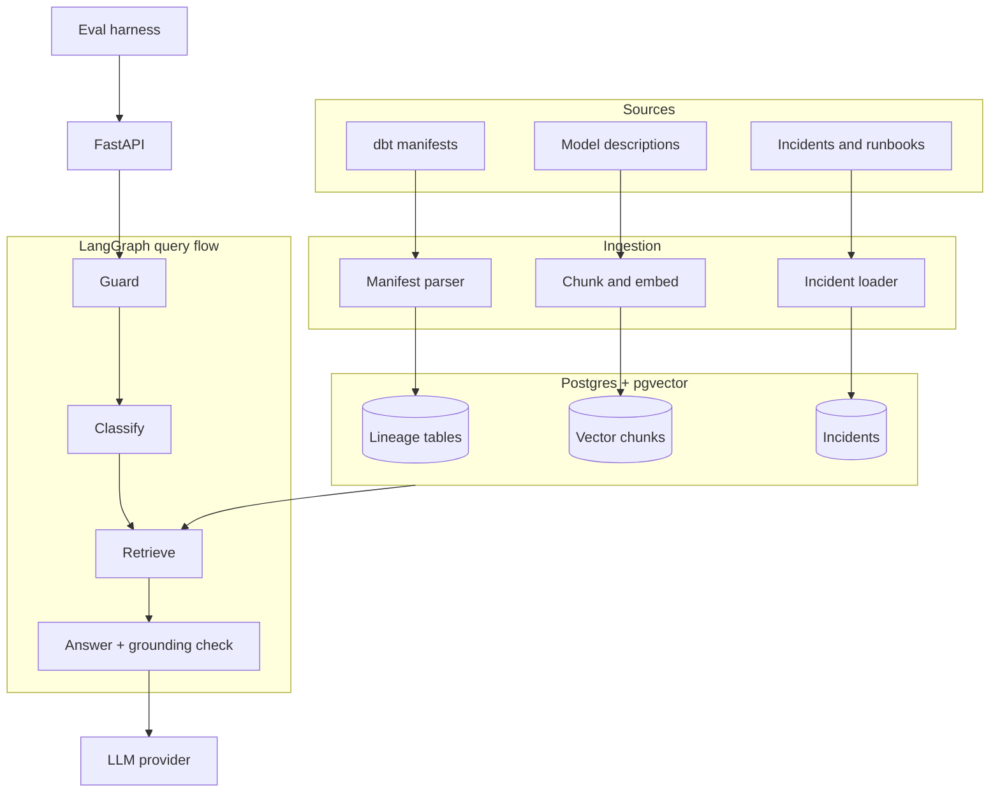

# asklineage

**Ask your data platform.** An open-source assistant that answers the questions flooding data-team Slack channels:

- Where does `net_revenue` come from, and which sources feed it?
- Who owns this model? Has it broken before, and how was it fixed?
- If I change this model, what breaks downstream?
- Which table should I use for "active customers"?

It reads your dbt artifacts, incident postmortems and runbooks, and answers with citations. Lineage answers come from a graph query, not from the LLM's memory.

> **Status:** early build, Phase 0 (foundation). Follow along as it's built in public.

## Why build this when vendors sell it?

Snowflake Cortex, dbt Wizard, Atlan and DataHub already cover parts of this. asklineage is a **reference build**, not a product pitch:

1. **Build vs. buy:** what it takes to build what these vendors sell, and where doing it yourself wins or loses.
2. **Across boundaries:** works across warehouses (Snowflake and BigQuery) and treats incident history as data you can query.
3. **For small teams:** runs on a single Postgres, no enterprise catalog contract needed.

## Architecture



## Roadmap

| Phase | Goal | Status |
|---|---|---|
| 0 | Foundation: project layout, Postgres + pgvector, CI | In progress |
| 1 | Lineage MVP: manifest parser, graph queries, answer with grounding, eval set | Planned |
| 2 | Semantic search and question routing | Planned |
| 3 | Incident history and hybrid retrieval | Planned |
| 4 | Refresh on every dbt deploy | Planned |
| 5 | Trade-off experiments: pgvector vs. Pinecone, LLM providers, column-level lineage | Planned |
| 6 | Hardening: auth, observability, deployment | Planned |

## Quickstart

Requires Python 3.12, [uv](https://docs.astral.sh/uv/) and Docker.

```bash
cp .env.example .env
docker compose up -d
uv sync
uv run uvicorn asklineage.main:app --reload
```

Then open <http://localhost:8000/health/ready>.

Run the tests:

```bash
uv run pytest
```

## License

MIT
