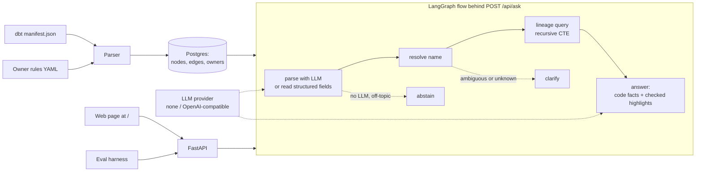

# asklineage

**Ask your data platform.** An open-source assistant that answers the questions flooding data-team Slack channels about a dbt project:

- Where does this model's data come from?
- If I change this model, what breaks downstream?
- Who owns it?
- (Planned) Has it broken before, and how was it fixed?

Lineage answers come from a graph query over your dbt manifest, **not from the LLM's memory**. The code writes the table, the counts and the owner information; an LLM, if you configure one, only reads your question and adds a few relation highlights that code checks before they are shown. With no LLM at all it still works through a structured form.

> **Status:** Phase 1 (lineage MVP) is built and evaluated. Incident history, semantic search and refresh on deploy are planned. See the [roadmap](#roadmap).

<!-- TODO: add a screenshot of the web page here, e.g. docs/images/web-ui.png -->
> **Screenshot placeholder:** the web page at <http://localhost:8000/> (question box, lineage graph, table, "how this was answered" panel). Add `docs/images/web-ui.png` and replace this block with ``.

## Why build this when vendors sell it?

Snowflake Cortex, dbt Wizard, Atlan and DataHub already cover parts of this. asklineage is a **reference build**, not a product pitch:

1. **Build vs. buy:** what it takes to build what these vendors sell, and where doing it yourself wins or loses. Every design choice is a written trade-off in [`docs/decisions/`](docs/decisions/).
2. **Across boundaries:** meant to work across warehouses (the sample project is BigQuery; a Snowflake project is planned) and to treat incident history as data you can query.
3. **For small teams:** runs on a single Postgres, no enterprise catalog contract needed.

## Architecture

What is built today:



Planned on top of this (Phases 2 to 4): pgvector chunks of model descriptions for semantic search, a question classifier, synthetic incidents and runbooks with hybrid retrieval, and refresh on every dbt deploy.

Key design rules:

- **Code writes the facts; the LLM only adds highlights.** The table and the summary paragraph (counts, teams affected, where owners came from, truncation) come from the SQL result. The LLM may add one to three relation highlights; each is checked in code (the edge or path exists in the stated direction, names are real, no numbers, no owner wording) and dropped if it fails after one retry ([ADR 0007](docs/decisions/0007-claims-based-grounding.md)).
- **A fuzzy match never answers.** A misspelt or ambiguous name returns candidates to choose from ([ADR 0004](docs/decisions/0004-name-resolution-never-guesses.md)).
- **Owners say where they came from.** Every owner shows its `owner_source`, and "no owner recorded" is said out loud ([ADR 0003](docs/decisions/0003-ownership-fallback.md)).
- **Lineage is model-level.** Column-level lineage needs SQL parsing and is planned for Phase 5.

## Quickstart

Requires Python 3.12, [uv](https://docs.astral.sh/uv/) and Docker.

**1. Clone, configure and start Postgres.**

```bash
git clone https://github.com/<your-account>/asklineage.git
cd asklineage
cp .env.example .env
docker compose up -d
```

**2. Install and create the tables.**

```bash
uv sync
uv run asklineage init-db
```

**3. Get a dbt manifest.** The repo is developed against the Cal-ITP `data-infra` project; see [Sample data](#sample-data). Skip to step 4 if you already have a `manifest.json` (schema v12) of your own.

*Browser:* open <https://github.com/cal-itp/data-infra/archive/546e3548a1b594b7f52728ce46311f2d45a0dc82.zip>, which downloads a zip of the pinned commit. Unzip it into `data/raw/` and rename the folder to `data-infra`, so that `data/raw/data-infra/warehouse/` exists.

*CLI:*

```bash
git clone https://github.com/cal-itp/data-infra.git data/raw/data-infra
git -C data/raw/data-infra checkout 546e3548a1b594b7f52728ce46311f2d45a0dc82
```

Then produce the manifest. `dbt parse` needs no warehouse access; `tools/dbt/profiles.yml` is a placeholder profile.

```bash
DBT_PROFILES_DIR=tools/dbt uvx --python 3.12 --from "dbt-core==1.10.8" --with "dbt-bigquery==1.10.2" \
  dbt parse --project-dir data/raw/data-infra/warehouse
mkdir -p data/manifests/calitp
cp data/raw/data-infra/warehouse/manifest.json data/manifests/calitp/manifest.json
```

Warnings about missing `external_enghouse` sources come from a bug in their project and can be ignored.

**4. Load it with the owner rules.** `config/owners.calitp.yml` assigns owners by folder path (synthetic: Cal-ITP's dbt project records none), with some folders left unowned on purpose.

```bash
uv run asklineage load-manifest data/manifests/calitp/manifest.json --owners config/owners.calitp.yml
```

**5. Try it from the command line, then start the server.**

```bash
uv run asklineage lineage dim_schedule_feeds --direction downstream --depth 2
uv run uvicorn asklineage.main:app --reload
```

**6. Open <http://localhost:8000/>.** With the default `LLM_PROVIDER=none`, use the **Structured** mode (node, direction, depth). Free-text questions need an LLM and will abstain with `llm_off`; the page says so in its header.

Run the tests (they need the Postgres container from step 1):

```bash
uv run ruff format . && uv run ruff check . && uv run pytest
```

### Optional: a local LLM for free-text questions

Any server that speaks the OpenAI chat API works (Ollama, vLLM, LiteLLM, a hosted gateway). The recommended local setup is Ollama with `qwen2.5:7b`, which is what the evaluation below used.

*Browser:* download Ollama from <https://ollama.com/download>, install it and open the app. Then pull the model from a terminal:

```bash
ollama pull qwen2.5:7b
```

*CLI (macOS with Homebrew):*

```bash
brew install ollama
ollama serve
```

In a second terminal:

```bash
ollama pull qwen2.5:7b
```

Then set these in `.env` (the base URL and model shown are the defaults):

```bash
LLM_PROVIDER=openai_compatible
LLM_BASE_URL=http://localhost:11434/v1
LLM_MODEL=qwen2.5:7b
```

Check the connection, then restart uvicorn:

```bash
uv run asklineage llm-check
```

Now the free-text box answers questions like "What depends on dim_schedule_feeds?" and follow-ups like "And upstream?" when **Conversation** is ticked before the first question. The "how this was answered" panel on each card shows every model call, its latency and tokens, and what it replied.

## Using the API

The page is a single static file that only calls the API.

```bash
curl -s localhost:8000/api/info
curl -s localhost:8000/api/ask -H 'content-type: application/json' -d '{"node": "dim_schedule_feeds"}'
curl -s localhost:8000/api/ask -H 'content-type: application/json' -d '{"question": "What depends on dim_schedule_feeds?", "start_thread": true}'
```

`POST /api/ask` returns one of three kinds: `lineage` (summary, highlights, table, edges, facts), `clarification` (candidates to choose from) or `abstain` (a reason and a message). Threads are opt-in: `start_thread` returns a server-issued `thread_id` for follow-ups and for resuming a clarification ([ADR 0009](docs/decisions/0009-conversation-threads.md)). `/api/info` returns the loaded projects and the configured LLM provider and model, never the key or the base URL.

## Sample data

The sample project is the Cal-ITP `data-infra` dbt project (BigQuery), pinned to commit `546e3548a1b594b7f52728ce46311f2d45a0dc82`, the `warehouse/` folder.

- **License:** `cal-itp/data-infra` is AGPL-3.0. Its files and the generated manifest are never committed here (`data/raw/` and `data/manifests/` are git-ignored). You download them yourself, as above.
- **Shape:** 628 models, 220 sources, 17 seeds, 351 tests and 1,198 edges into models. 67% of models and 79% of columns have descriptions. **dbt records no owners**, so the owner rules file is synthetic and path-based, with 27 nodes left unowned on purpose.
- **Not available from `dbt parse`:** `catalog.json` (column types) and `run_results.json` (run history) need a live warehouse.
- **Why not GitLab's analytics repo?** It was the first choice and went private in 2026.

## Evaluation: first results

Each layer is measured separately ([ADR 0010](docs/decisions/0010-eval-v1.md)). Commands:

```bash
uv run asklineage eval conformance data/manifests/calitp/manifest.json
uv run asklineage eval run data/manifests/calitp/manifest.json --source-repo data/raw/data-infra
```

- **Lineage is exact.** The conformance check compares the database with an independent stdlib traversal of the manifest for every node, in both directions, at depths 1, 2, 3, 5 and 25. On Cal-ITP that is **8,650 walks with 0 mismatches**, in about 9 seconds. CI runs the same check on a seeded synthetic manifest.
- **A 56-turn golden question set** is generated from the manifest at run time (never committed). The final run with `qwen2.5:7b` at temperature 0 scored **55 correct, 1 acceptable and 0 wrong of 56**: question reading 25/25 on node, direction and depth, follow-ups all right, and lineage tables and facts right on every answer. Without any LLM the same set gives 55 correct and 1 expected block.
- **The path there is part of the result.** Four runs changed what the model got wrong from 1.8 to 3.6 and then to 0 silent wrong answers per 100 turns, because fixing two safe failures exposed two silent ones. That is why outcomes are classed (correct, acceptable, safe wrong, silent wrong). The cause was a retry that flipped fields nobody had flagged; the fix freezes them.
- **Highlights are true but not well chosen.** Of 101 kept highlights, the manifest contradicted none. But the LLM's pick of *which* relations to mention was worse than a random pick on the usefulness proxy (minority-team hit 3/17 against 17/17 for a simple code rule and 16/17 for random), and it adds about 4 seconds per answer. Moving that choice into code is **deferred to Phase 6** with a bigger golden set and hand labels; the decision record will say why.
- **Caveats:** one model, one run per setting, 56 turns. "0 wrong" means none in these 56, not a rate.

## Roadmap

| Phase | Goal | Status |
|---|---|---|
| 0 | Foundation: project layout, Postgres + pgvector, CI | Done |
| 1 | Lineage MVP: manifest parser, graph queries, LLM provider interface, LangGraph flow and `/api/ask`, web page, eval v1 | Done |
| 2 | Semantic search over model descriptions and a question classifier | Planned |
| 3 | Synthetic incidents, runbooks and Slack threads; hybrid retrieval | Planned |
| 4 | Refresh on every dbt deploy; a second project (Snowflake); manifest diffing | Planned |
| 5 | Trade-off experiments: pgvector vs. Pinecone, LLM providers, column-level lineage | Planned |
| 6 | Hardening: auth, observability, deployment, eval in CI; eval v2 (bigger golden set, hand labels, highlights chosen in code) | Planned |

## Known limits

- Lineage is model-level, not column-level.
- No authentication yet; a thread ID works like a bearer token. Phase 6.
- Owners in the sample are synthetic.
- The web page has no automated JavaScript tests; it is checked by hand. A star-shaped lineage (one node with dozens of children) draws as a tall fan, and the graph is capped at 40 nodes (the table always lists all).
- Free-text questions need an LLM, and only one small model has been evaluated.

## Design decisions

Each is a short record with the options compared: [`docs/decisions/`](docs/decisions/).

| | |
|---|---|
| [0001](docs/decisions/0001-postgres-for-lineage.md) | Postgres adjacency list and recursive CTEs, not a graph database |
| [0002](docs/decisions/0002-dbt-artifacts-as-interface.md) | Read dbt artifacts; never import dbt |
| [0003](docs/decisions/0003-ownership-fallback.md) | Path-based owner rules when dbt has no owners |
| [0004](docs/decisions/0004-name-resolution-never-guesses.md) | Name resolution returns candidates; a fuzzy match never answers |
| [0005](docs/decisions/0005-bounded-traversal.md) | Bounded traversal: depth cap and per-level dedup |
| [0006](docs/decisions/0006-llm-provider-interface.md) | Narrow LLM provider interface; OpenAI-compatible first; none by default |
| [0007](docs/decisions/0007-claims-based-grounding.md) | Code writes the facts; the LLM adds checked highlights |
| [0008](docs/decisions/0008-langgraph-orchestrator.md) | LangGraph orchestrates `/api/ask` |
| [0009](docs/decisions/0009-conversation-threads.md) | Opt-in conversation threads in Postgres |
| [0010](docs/decisions/0010-eval-v1.md) | Eval v1: conformance, golden set, scoring |
| [0011](docs/decisions/0011-web-ui.md) | One static page served by FastAPI, with a hand-written SVG graph |

## License

MIT. The Cal-ITP sample data is AGPL-3.0 and is not distributed with this repository.
